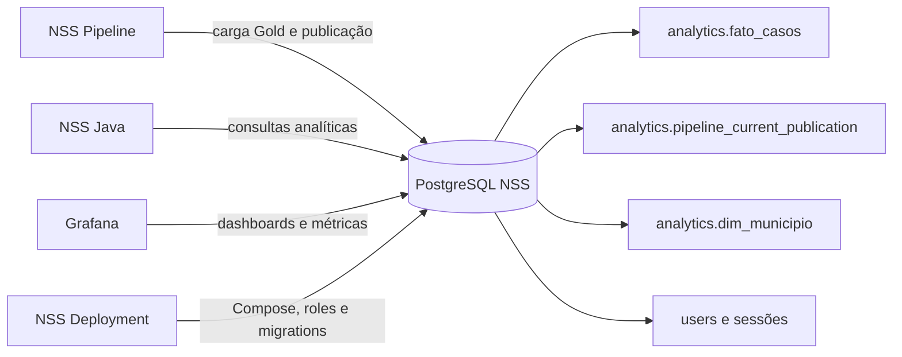
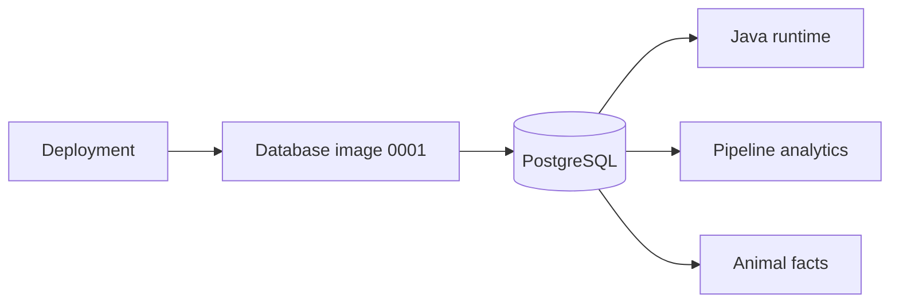

# NSS Database

Documentação e contrato do banco de dados da plataforma NSS (Sala de Situação de Saúde).

Este repositório mantém a versão inicial 0001 dos schemas operacional e analítico, o provisionamento das roles e os testes do contrato do banco. O job central aplica cada componente ao banco configurado e registra o checksum em `nss_schema.version`. Schemas legados sem histórico central são rejeitados e exigem migração de dados própria.

## Repositórios relacionados

- [NSS Deployment](https://github.com/Zadoque/NSS-deployment): composição dos serviços, banco, roles e execução.
- [NSS Pipeline](https://github.com/Zadoque/NSS-pipeline): Bronze, Silver, Gold e carga analítica.
- [NSS Java](https://github.com/Zadoque/Site-Sala-de-Situa-o-de-Saude-Java): API, autenticação e consultas do banco.
- [NSS Front-end](https://github.com/Zadoque/NSS-front-end): aplicação web consumidora da API.

## Visão geral

## Documentação

- [Arquitetura e responsabilidades](docs/architecture.md)
- [Catálogo de consultas e desempenho](docs/query-catalog.md)
- [Diagrama do modelo analítico](diagrams/analytics-erd.md)

## Princípios

1. `analytics.fato_casos` é o read model analítico consumido pela API.
2. `analytics.pipeline_current_publication` define o lote corrente por doença, ano e município.
3. Consultas da API devem respeitar a publicação corrente e nunca misturar lotes antigos.
4. Toda mudança de schema deve ter migration, teste e medição de impacto.
5. Resultados de `EXPLAIN (ANALYZE, BUFFERS)` devem ser registrados quando uma consulta crítica for alterada.

## Arquitetura e estrutura

`migrations/` contém a única migration; `scripts/` provisiona papéis e verifica o schema; `tests/` cobre criação vazia, reexecução e permissões; `documentation/` registra contratos. Java e pipeline consomem o schema centralizado e não mantêm migrations concorrentes.
