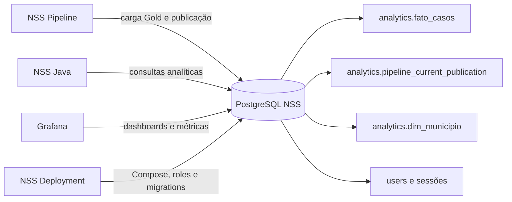
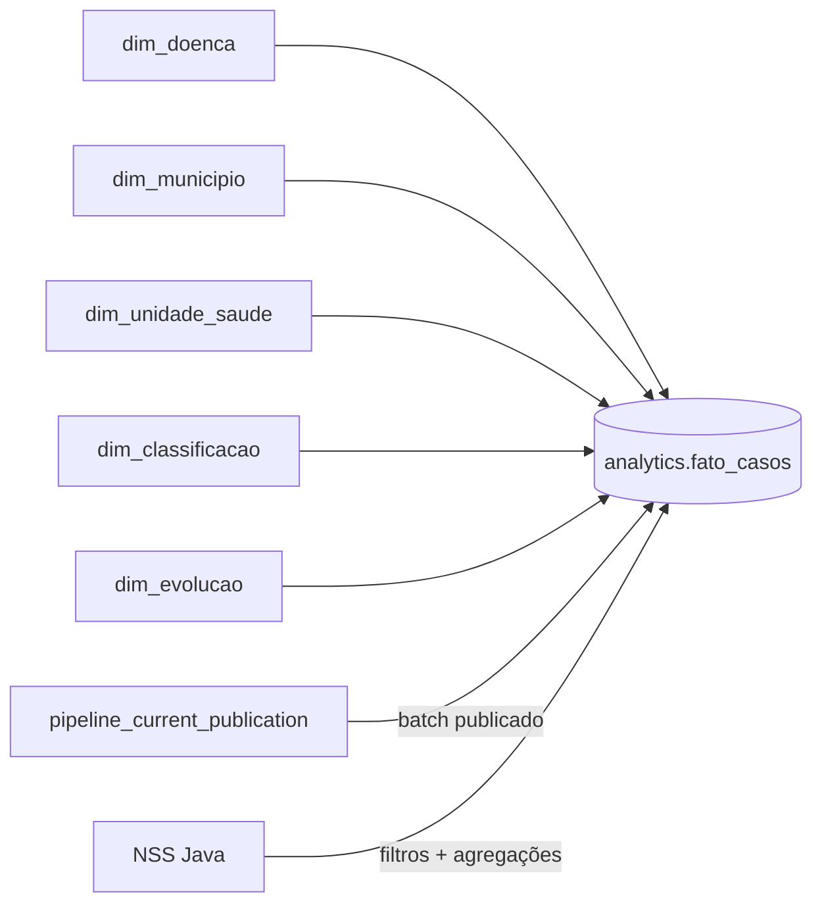
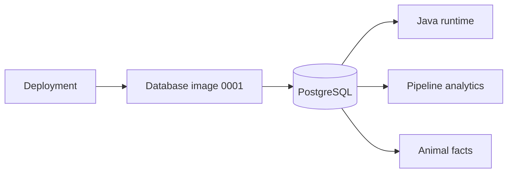

# NSS Database

## Ambiente de execução

Este repositório versiona apenas `.env.example` quando necessário para testes;
nenhum secret de produção pertence aqui. No servidor, os valores são compostos
pelo Deployment em `/etc/nss/deployment.env` (modo `0600`) e usados para criar
as roles e aplicar a migration central.

Para teste local do componente: `cp .env.local.test .env`. Em uma instalação
integrada, prefira sempre o arquivo do Deployment para manter as credenciais
coerentes entre banco, Java e pipeline.

Documentação e contrato do banco de dados da plataforma NSS (Sala de Situação de Saúde).

Este repositório mantém a versão inicial 0001 dos schemas operacional e analítico, o provisionamento das roles e os testes do contrato do banco. O job central aplica cada componente ao banco configurado e registra o checksum em `nss_schema.version`. Schemas legados sem histórico central são rejeitados e exigem migração de dados própria.

## Repositórios relacionados

- [NSS Deployment](https://github.com/Zadoque/NSS-deployment): composição dos serviços, banco, roles e execução.
- [NSS Pipeline](https://github.com/Zadoque/NSS-pipeline): Bronze, Silver, Gold e carga analítica.
- [NSS Java](https://github.com/Zadoque/Site-Sala-de-Situa-o-de-Saude-Java): API, autenticação e consultas do banco.
- [NSS Front-end](https://github.com/Zadoque/NSS-front-end): aplicação web consumidora da API.

## Visão geral

## Documentação

- [Arquitetura e responsabilidades](docs/architecture.md)
- [Catálogo de consultas e desempenho](docs/query-catalog.md)
- [Diagrama do modelo analítico](diagrams/analytics-erd.md)

## Princípios

1. `analytics.fato_casos` é o read model analítico consumido pela API.
2. `analytics.pipeline_current_publication` define o lote corrente por doença, ano e município.
3. Consultas da API devem respeitar a publicação corrente e nunca misturar lotes antigos.
4. Toda mudança de schema deve ter migration, teste e medição de impacto.
5. Resultados de `EXPLAIN (ANALYZE, BUFFERS)` devem ser registrados quando uma consulta crítica for alterada.

## Modelo analítico estrela e consultas

O schema `analytics` usa um modelo estrela: `fato_casos` é a tabela fato central,
com a medida `cases_total`, e as dimensões fornecem os atributos usados nos
filtros e agrupamentos da API. A tabela `pipeline_current_publication` funciona
como controle de publicação e limita cada consulta ao lote corrente.

O Java normalmente executa uma consulta de total e uma consulta agrupada por
território (município, distrito ou bairro). As consultas filtram doença, ano,
município, distrito, sexo, faixa etária e `batch_id` publicado; não leem lotes
antigos nem fazem soma no frontend. Índices compostos e `INCLUDE` cobrem os
predicados mais seletivos. O catálogo em
[`docs/query-catalog.md`](docs/query-catalog.md) registra SQL, planos
`EXPLAIN (ANALYZE, BUFFERS)`, comparativos antes/depois e condições do benchmark.

No recorte de referência DENG/2024/Rio de Janeiro, medido em um Intel(R)
Core(TM) i7-2600 CPU @ 3.40GHz, com 4 threads disponíveis e 15 GiB de RAM, o
plano otimizado reduziu a
consulta de totais de aproximadamente 65,6 ms para 29,6 ms e a agregação por
bairros de aproximadamente 230 ms para 60 ms com `work_mem=64MB`. Esses valores
são evidências do ambiente medido, não um SLO universal; qualquer alteração de
consulta deve repetir a medição informando volume, hardware, filtros e cache.

## Arquitetura e estrutura

`migrations/` contém a única migration; `scripts/` provisiona papéis e verifica o schema; `tests/` cobre criação vazia, reexecução e permissões; `documentation/` registra contratos. Java e pipeline consomem o schema centralizado e não mantêm migrations concorrentes.
