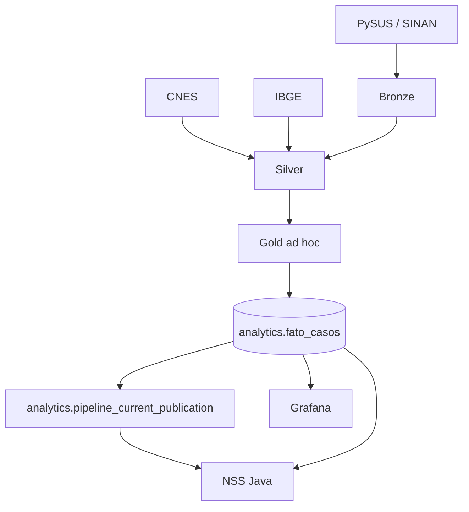
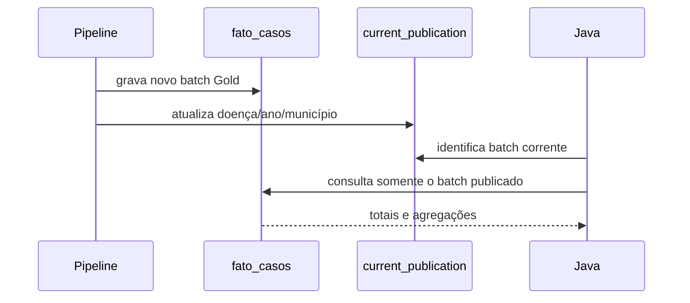

# Arquitetura do banco

## Bancos e responsabilidades

O PostgreSQL utilizado pelo deployment contém a base operacional da aplicação e o schema analítico. A separação de acesso é feita por roles, conforme o ambiente:

| Componente | Responsabilidade | Acesso principal |
|---|---|---|
| Java | autenticação e leitura analítica | leitura de `analytics` e escrita operacional |
| Pipeline | publicação de dados Gold | escrita controlada em `analytics` |
| Grafana | dashboards | somente leitura |
| Migrate | evolução estrutural | DDL e grants |

## Fluxo de dados



## Tabelas analíticas principais

### `analytics.fato_casos`

Fato agregado por doença, ano, mês, município, unidade, classificação, evolução, sexo, faixa etária e território da notificação. `cases_total` é a medida principal.

Os campos `notification_district_id`, `notification_neighborhood_id` e `notification_territory_status` representam o resultado do enriquecimento territorial da pipeline.

### `analytics.pipeline_current_publication`

Tabela de controle que aponta o `batch_id` atualmente publicado para cada combinação de doença, ano e município. Possui chave primária em:

```text
(disease_codigo, ano, cd_mun)
```

A API usa essa tabela para filtrar os fatos publicados e evitar a leitura de snapshots antigos.

### Dimensões

- `analytics.dim_doenca`
- `analytics.dim_municipio`
- `analytics.dim_unidade_saude`
- `analytics.dim_classificacao`
- `analytics.dim_evolucao`

## Publicação



## Migrations

A configuração inicial `0001` deste repositório contém os componentes `app` e `analytics`, incluindo `analytics_animal.fato_esporo`. O job central provisiona roles, aplica cada componente ao banco configurado e registra a versão e o checksum em `nss_schema.version`. Bancos novos podem compartilhar a mesma base ou usar bases distintas. Bancos legados sem histórico central são recusados e precisam de um procedimento de transferência e validação antes da adoção.
